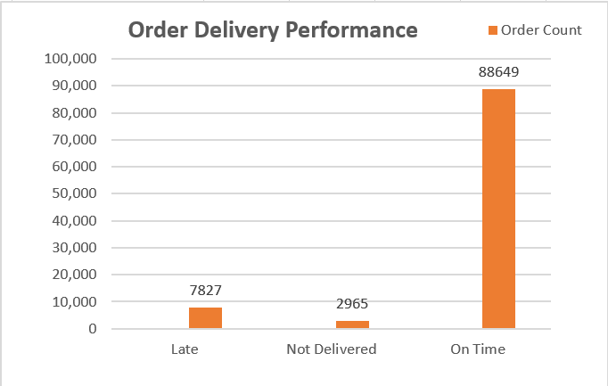
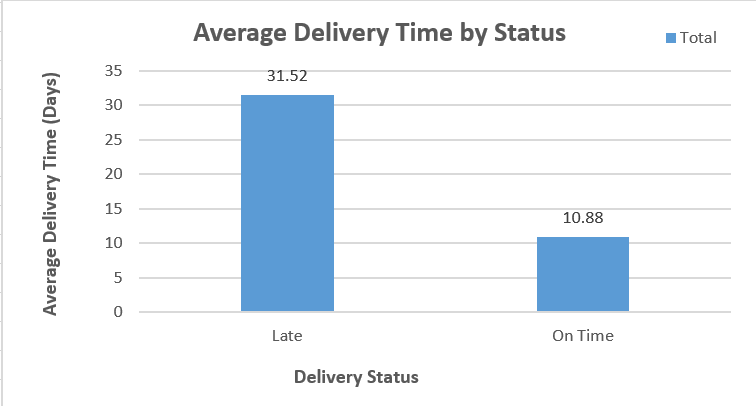
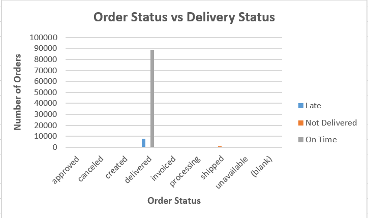

# Olist E-commerce Sales & Delivery Analytics

## Project Overview
This project analyses e-commerce order and delivery data from the Brazilian Olist marketplace to understand delivery performance, order statuses, and customer fulfilment outcomes.

The objective is to identify delivery trends, measure on-time delivery performance, and derive actionable insights using Excel-based data analysis.

## Business Objectives
- Measure on-time and late delivery performance.
- Calculate average delivery duration.
- Analyse order statuses alongside delivery classifications.
- Identify potential data-quality issues.
- Present findings in clear, business-oriented charts.

## Tools Used
- Microsoft Excel
- PivotTables and PivotCharts
- Excel formulas
- GitHub for project version control and documentation

## Dataset
The project uses the Olist Brazilian E-commerce Public Dataset.

The analysis currently focuses on the orders dataset, including:
- Order purchase timestamp
- Actual customer delivery date
- Estimated delivery date
- Order status

Original dataset source: https://www.kaggle.com/datasets/olistbr/brazilian-ecommerce

## Data Preparation
Two calculated columns were added:

### Delivery Days
Calculated as the difference between the actual customer delivery timestamp and the purchase timestamp. Orders without a recorded actual delivery date are left blank.

### Delivery Status
Orders are classified as:
- **On Time:** Actual delivery date is on or before the estimated delivery date.
- **Late:** Actual delivery date is after the estimated delivery date.
- **Not Delivered:** No actual customer delivery date is recorded.

## Key Findings

Based on the current Excel analysis of 99,441 orders:

| Metric | Result |
|---|---:|
| Total orders | 99,441 |
| On-time orders | 88,649 |
| Late orders | 7,827 |
| Orders without recorded delivery dates | 2,965 |
| On-time rate among orders with recorded delivery dates | 91.89% |
| Average delivery duration for on-time orders | 10.88 days |
| Average delivery duration for late orders | 31.52 days |

These are preliminary results from the current workbook and may be refined during further validation.

## Excel Analysis
The workbook contains three main analyses:

1. **Delivery Performance:** Order counts and percentages by delivery classification.
2. **Average Delivery Time:** Average delivery duration for on-time and late orders.
3. **Order Status vs Delivery Status:** Cross-tabulation of order statuses and delivery classifications.

Charts were created to communicate these results visually.

## Data Quality Notes
Some orders have an order status of `delivered` but lack a recorded actual customer delivery date. These records require further investigation before drawing conclusions about their delivery outcomes.

The delivery status classification is based on recorded dates and does not independently verify the operational status of each order.

## Repository Structure

```text
olist-ecommerce-sales-analytics/
├── dashboard/
├── data/
├── screenshots/
├── sql/
├── Olist_Orders_Analysis.xlsx
└── README.md
```

## Future Improvements
- Add SQL queries for order and delivery analysis.
- Build an interactive Power BI dashboard.
- Analyse customer reviews and satisfaction.
- Investigate missing delivery dates and other data-quality issues.
- Explore delivery performance by geography, seller, and product category.

## Author
Data Analytics Portfolio Project

## Disclaimer
This project is intended for educational and portfolio purposes. Findings reflect the fields and records available in the source dataset and should be interpreted in that context.

## 📊 Excel Analysis & Visualizations

### 1. Order Delivery Performance



### 2. Average Delivery Time by Status



### 3. Order Status vs Delivery Status


