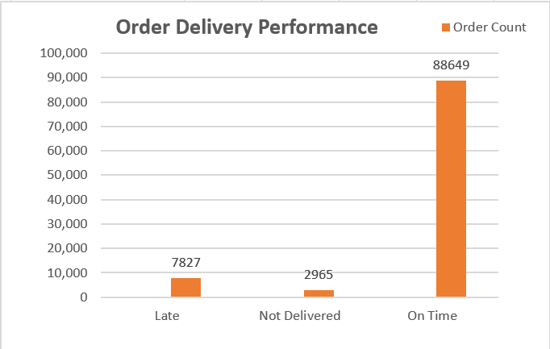
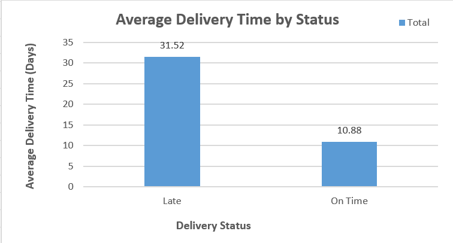
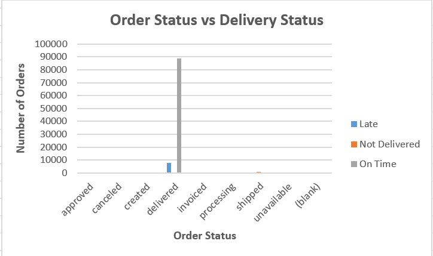

# Olist E-commerce Sales & Delivery Analytics

## Project Overview

This project analyses e-commerce data from the Brazilian Olist marketplace to understand sales performance, customer purchasing behaviour, payment patterns, product performance, and delivery outcomes.

The objective is to transform raw e-commerce data into meaningful business insights using **Microsoft Excel and MySQL**, with an interactive Power BI dashboard planned as the next phase.

## Business Objectives

- Measure on-time and late delivery performance.
- Calculate average delivery duration and identify delivery delays.
- Analyse order statuses and customer fulfilment outcomes.
- Understand customer purchasing behaviour and repeat purchases.
- Evaluate payment methods and transaction values.
- Identify top-performing products and product categories.
- Examine data quality issues and missing values.
- Present findings through business-oriented analysis and visualizations.

## Tools & Technologies

- **Microsoft Excel:** Data cleaning, calculated columns, PivotTables, PivotCharts and analysis.
- **MySQL:** Data importing, transformation, data validation, joins, aggregations and analytical queries.
- **GitHub:** Version control and project documentation.
- **Power BI:** Planned for interactive dashboard development.

## Dataset

The project uses the **Olist Brazilian E-commerce Public Dataset**.

Original dataset source: https://www.kaggle.com/datasets/olistbr/brazilian-ecommerce

The SQL analysis currently covers the following datasets:

- Orders
- Customers
- Order Payments
- Order Items
- Products

## Data Preparation

### Excel Data Preparation

Two calculated columns were created in the orders dataset.

**Delivery Days**

Calculated as the difference between the actual customer delivery timestamp and the purchase timestamp. Orders without a recorded actual delivery date are left blank.

**Delivery Status**

Orders are classified into three categories:

- **On Time:** Actual delivery date is on or before the estimated delivery date.
- **Late:** Actual delivery date is after the estimated delivery date.
- **Not Delivered:** No actual customer delivery date is recorded.

### SQL Data Preparation

MySQL was used to import and transform the raw CSV datasets.

Key preparation activities included:

- Creating staging tables for raw CSV imports.
- Converting date strings into MySQL DATETIME values.
- Converting numeric text columns into appropriate numeric data types.
- Handling blank values using `NULLIF()` and `TRIM()`.
- Validating record counts and distinct identifiers.
- Checking missing values and data consistency.
- Creating cleaned analytical tables for reporting.

## Excel Analysis

The Excel workbook contains three main analyses:

1. **Delivery Performance:** Order counts and percentages by delivery classification.
2. **Average Delivery Time:** Average delivery duration for on-time and late orders.
3. **Order Status vs Delivery Status:** Cross-tabulation of order statuses and delivery classifications.

### Preliminary Excel Findings

Based on the current Excel workbook:

| Metric | Result |
|---|---:|
| Total orders | 99,441 |
| On-time orders | 88,649 |
| Late orders | 7,827 |
| Orders without recorded delivery dates | 2,965 |
| On-time rate among orders with recorded delivery dates | 91.89% |
| Average delivery time for on-time orders | 10.88 days |
| Average delivery time for late orders | 31.52 days |

These are preliminary workbook results. A small discrepancy with the independently calculated SQL delivery counts remains under validation.

## SQL Analysis

SQL analysis was performed using **MySQL 8.0** across five datasets.

### 1. Orders Analysis

Key areas analysed:

- Total order volume and unique orders.
- On-time and late delivery performance.
- Average delivery duration.
- Average delay among late orders.
- Monthly delivery performance.
- Delivery delay severity.
- Order status and missing delivery timestamps.

**Key findings:**

| Metric | Result |
|---|---:|
| Total orders | 99,441 |
| Delivered orders with valid actual delivery dates | 96,470 |
| On-time delivered orders | 88,644 |
| Late delivered orders | 7,826 |
| On-time rate among valid delivered records | 91.89% |
| Average actual delivery duration | 12.50 days |
| Average delay for late orders | 8.87 days |

### 2. Customer Analysis

Key areas analysed:

- Total customers and unique customer identities.
- One-time and repeat customers.
- Repeat customer rate.
- Customer distribution by Brazilian state.
- State-wise delivery performance.

**Key findings:**

| Metric | Result |
|---|---:|
| Total customer records | 99,441 |
| Unique customers | 96,096 |
| One-time customers | 93,099 |
| Repeat customers | 2,997 |
| Repeat customer rate | 3.12% |

São Paulo (SP) accounted for approximately 41.9% of unique customers, making it the largest customer market in the dataset.

### 3. Payments Analysis

Key areas analysed:

- Transaction counts by payment method.
- Total payment value by payment method.
- Average payment value.
- Payment data quality and validation.

**Key findings:**

| Metric | Result |
|---|---:|
| Total payment records | 103,886 |
| Unique orders with payment records | 99,440 |
| Total payment value | R$16,008,872.12 |
| Average payment per record | R$154.10 |

Credit cards accounted for the largest transaction volume and total payment value.

### 4. Order Items Analysis

Key areas analysed:

- Total order items.
- Unique orders, products and sellers.
- Total product sales value.
- Total freight value.
- Top 10 products by sales value.
- Average Order Value (AOV).

**Key findings:**

| Metric | Result |
|---|---:|
| Total order items | 112,650 |
| Unique orders | 98,666 |
| Unique products | 32,951 |
| Unique sellers | 3,095 |
| Total product sales value | R$13,591,643.70 |
| Total freight value | R$2,251,909.54 |
| Average Order Value | R$137.75 |

### 5. Products Analysis

Key areas analysed:

- Product category distribution.
- Category-wise order volume.
- Units sold by category.
- Total sales by product category.
- Missing product category information.

**Key findings:**

| Metric | Result |
|---|---:|
| Total products | 32,951 |
| Distinct product categories | 73 |
| Products with missing categories | 610 |

The top-performing category by sales value was **Health & Beauty**, generating R$1,258,681.34 in product sales.

## SQL Concepts Demonstrated

The project applies practical SQL concepts used in Data Analyst roles:

- Database and table creation.
- `LOAD DATA LOCAL INFILE`
- Data type conversion using `CAST()` and `STR_TO_DATE()`.
- Missing value handling using `NULLIF()` and `TRIM()`.
- Data validation using `COUNT()` and `COUNT(DISTINCT)`.
- Filtering using `WHERE`.
- Aggregation using `SUM()`, `AVG()` and `COUNT()`.
- Grouping using `GROUP BY`.
- Sorting and limiting results using `ORDER BY` and `LIMIT`.
- Table joins using `INNER JOIN`.
- Subqueries for calculating Average Order Value.

## Data Quality Notes

- Some orders have a `delivered` status but lack a recorded actual customer delivery timestamp.
- Some product records have missing category information.
- Three payment records have an undefined payment type.
- One order in the orders dataset does not have a corresponding payment order ID.
- Excel and SQL delivery counts have a small discrepancy that requires reconciliation.

These limitations are considered when interpreting the analysis. Missing or incomplete records are not automatically treated as confirmed operational outcomes.

## Repository Structure

```text
olist-sales-delivery-analysis/
│
├── Olist_Orders_Analysis.xlsx
├── olist-ecommerce-sales-analytics.sql
├── README.md
│
├── delivery_performance.png
├── average_delivery_time.png
└── order_status_analysis.png
```

## Future Improvements

- Build an interactive Power BI dashboard.
- Create KPI cards and interactive visualizations.
- Analyse sales, customer behaviour and delivery performance through dashboard reporting.
- Reconcile data-quality discrepancies between Excel and SQL.
- Expand the analysis with additional business insights where relevant.

## Author

Data Analytics Portfolio Project

## Disclaimer

This project is intended for educational and portfolio purposes. It uses publicly available Olist marketplace data. Findings reflect the records and fields available in the source dataset and should be interpreted within that context.

## Excel Analysis & Visualizations

### 1. Order Delivery Performance



### 2. Average Delivery Time by Status



### 3. Order Status vs Delivery Status


